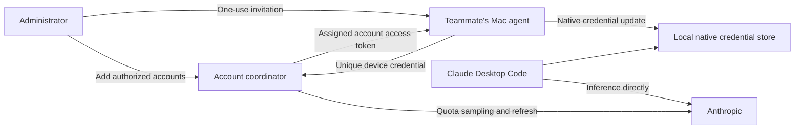

# Native team pool: design assessment

Status: assessed design, not an implemented or deployed feature. Prepared October 24, 2026.

## Recommendation

The requested experience is technically plausible: each teammate installs once, redeems an invitation, and uses local Claude Desktop Code with a centrally managed subscription pool. Keep inference direct to Anthropic and retain each teammate's Desktop login and conversation index.

Proceed first with a bounded two-Mac compatibility prototype. The existing single-Mac launcher does not prove that ordinary access-token-only credentials can be renewed across devices without a login or trusted-device challenge. Do not promise a team rollout or identical native capabilities until that test passes.

## Teammate experience

1. An administrator creates a short-lived, single-use invitation for one teammate/device.
2. The teammate runs the signed/reviewable installer and enters the invitation through a hidden prompt. Do not put credentials in shell arguments, URLs, or shell history.
3. Setup stores a unique device credential in the user's Keychain, installs a user LaunchAgent, and enables the existing Desktop process wrapper. The system wrapper needs the same one-time administrator approval as the current integration.
4. The teammate restarts Desktop once, keeps their existing Desktop login, and resumes a local Code conversation. The agent obtains the assigned subscription credential in the background.
5. The agent renews its assignment after startup, sleep/wake, and on a bounded interval. The coordinator handles quota selection and credential refresh.

"Set up once" means no routine account switching or repeated pool login by teammates. It cannot guarantee that a revoked account, expired device enrollment, changed OS permission, or future Desktop update will never require intervention.

## Components and data flow

The coordinator is a credential service, not an inference gateway. Prompts, files, and model responses do not need to pass through it. It sees enrolled devices, assignments, and account-level quota measurements. It cannot infer precise per-person token usage from shared account totals.

### Coordinator

- Own the authoritative pool credentials and all refresh operations. Start with one active instance and durable encrypted secret storage; do not introduce concurrent refresh writers through replicas or overlapping restarts.
- Persist refreshed credentials atomically and use upstream's locking/compare-and-swap semantics. A refresh accepted upstream followed by a local crash is a recovery case, not a reason to blindly replay an old refresh token.
- Sample quota centrally with bounded backoff. Workstation agents must not independently poll each account's usage endpoint.
- Assign accounts per device with stickiness, cooldown, and hysteresis. Use quota plus active assignments to avoid sending every teammate to the same apparently empty account at once. Assignment counts are only a load heuristic, not a measured per-person quota.
- Treat stale quota explicitly. Prefer a fresh eligible alternate; when all candidates are stale or exhausted, report that state instead of rotating blindly or switching to API billing.
- Maintain an admin-only device list and revocation action. Audit enrollment, assignment, refresh outcome, and revocation without logging tokens, request bodies, or account credential objects.

### Mac agent

- Store its coordinator credential in a separate Keychain item. Redeem a per-device invitation rather than sharing one permanent team-wide bearer.
- Receive only the assigned account's real access token, actual expiry, actual scopes, and minimal verified account metadata. Never download the whole pool, refresh tokens, trusted-device tokens, or another machine's MCP/plugin secrets.
- Update the native credential store through a reviewed adapter that respects Claude's local locks, cache invalidation, and machine-owned fields. A raw JSON overwrite is insufficient.
- Retain the process wrapper's removal of host-pinned authentication. Do not inject a fixed `CLAUDE_CODE_OAUTH_TOKEN` or file descriptor at process launch: that reintroduces credential pinning in long-running sessions.
- Stop independent local `cswap` auto-rotation for the managed store. Two selectors must not compete over the same active credential.
- Detect manual `/login`, `/logout`, or `cswap switch` changes and pause on unexpected credential drift. Do not overwrite a user's new login or repeatedly restore a credential they intentionally removed. Test whether `/logout` revokes a bearer still in use on another Mac.
- Preflight organization and provider policies such as `forceLoginOrgUUID`, `forceLoginMethod`, and `allowedProviders`. An assigned account must satisfy those policies; the agent must not clear them to make a pool assignment work.
- Keep the last valid credential during a temporary network failure, report degraded status, and retry with backoff and jitter. Do not silently substitute a personal account, API key, or paid billing path.

## Trust boundary: what the enrollment token does and does not hide

The team token authorizes access to the coordinator. Claude Desktop still needs a real Anthropic credential for native subscription inference. Each enrolled Mac therefore receives a usable provider bearer, even if the UI never displays it.

The coordinator cannot mint its own native subscription token, reduce an Anthropic token's scopes, or shorten its real validity. A five-minute assignment lease is not a five-minute provider token. Device revocation prevents future delivery, but a previously delivered credential may continue working until Anthropic expires or revokes it. Revoking that shared upstream credential can affect other teammates using it.

Consequences:

- This requires teammates and their Macs to be trusted with the assigned account. It does not provide per-person isolation for account-owned resources or server-enforced per-person spending limits.
- Sharing native credentials may expose access beyond model inference according to their real scopes. Keeping Desktop histories in place is not proof of account-level privacy isolation.
- The native store can also be used by terminal Claude Code. The prototype must establish that scope explicitly; changing it may affect CLI sessions on the same Mac. A separate `CLAUDE_CONFIG_DIR` also changes settings/history identity and is not a free isolation fix.
- Fast mode retains its separate paid-credit requirements. Subscription assignments do not replenish credits or make them part of included quota.

Anthropic's current [credential-use documentation](https://code.claude.com/docs/en/legal-and-compliance#authentication-and-credential-use) explicitly restricts collecting or intermediating claude.ai credentials and routing other users through Pro/Max credentials. This assessment distinguishes technical feasibility from permission to deploy that arrangement; an applicable agreement or permission would need to cover a production rollout.

## Why not distribute a setup-token or a pool export?

The official [`claude setup-token` flow](https://code.claude.com/docs/en/authentication#generate-a-long-lived-token) provides a long-lived subscription credential. Its documented capability limits and long validity make it a poor substitute for the intended renewable native account behavior. It is not a scoped team enrollment token.

A whole pool export is worse: it gives every device refresh credentials and makes them independent refresh writers. Existing cswap filesystem locks coordinate processes on one machine; they do not coordinate unrelated Macs. Copying an administrator's entire credential object can also copy machine-specific trusted-device or connector data.

## Migration of an existing personal pool

Do not simply upload the current pool and leave its local refresh/rotation running. Either provision a separately authenticated broker-owned credential lineage and validate concurrent sessions, or deliberately transfer exclusive ownership of the existing lineage.

A transfer needs a maintenance step: stop competing writers, preserve recoverable secrets securely, establish the authoritative server state, enroll the administrator's Mac as a client, replace its refresh-capable local material, then resume work. After any successful token rotation, rollback must use the current authoritative credentials; an old backup may contain a consumed refresh token.

No current account material should be exported as part of a design assessment or ordinary repository installation.

## Acceptance tests before a team build

| Test | Required result |
| --- | --- |
| Fresh second Mac | Access-token-only native credential works with the current Desktop build; no copied trusted-device secret is needed. Record any required per-device login. |
| Real token renewal | Broker refreshes once; both clients receive the replacement; neither attempts its own refresh. |
| Existing conversation | A new turn after assignment change uses the new account without changing Desktop login or moving history. |
| In-flight work | Record actual behavior for a streaming turn, a 429 retry loop, and a long-running subagent. Do not claim uninterrupted failover unless observed. |
| Quota pressure | Multiple clients share realistic quota; assignments remain stable and do not stampede the same alternate. |
| Expired/stale quota data | Backoff is respected; no fresh eligible account leads to an explicit wait state. |
| Sleep and outage | Wake renews before new work where possible; expired credentials produce a clear recoverable state. |
| Revocation | Future assignment requests fail; already-delivered provider tokens are tested to establish the real residual access window. |
| Capability boundary | Check model selection, local tools, account-scoped artifacts/connectors, Fast state, and CLI side effects without assuming parity. |
| Credential hygiene | Network payloads contain no refresh or machine-owned secrets; logs contain no tokens; uninstall preserves unrelated native settings and history. |
| Manual account changes | `/login`, `/logout`, and explicit account switches pause agent writes; establish whether upstream logout also disrupts other clients. |
| Organization policy | Incompatible pool accounts fail clearly under managed organization/provider restrictions; no policy is bypassed. |

Use a dedicated authorized test account and two controlled devices. Unit tests of invitation exchange and assignment logic are useful, but cannot establish these Desktop outcomes.

If fresh-device authentication or renewal requires copying refresh/trusted-device secrets to every Mac, stop and revisit the architecture. Do not turn that failure into an undocumented whole-account export. If the required capabilities need broader access than the team accepts, this native design does not meet the requirement.

## Smallest implementation after validation

1. **Coordinator:** authenticated enrollment, sticky assignments, admin revocation, one refresh owner, durable storage, centralized usage sampling, and TLS. Invitation redemption must be atomic and single-use.
2. **Mac agent:** hidden-prompt enrollment, Keychain device credential, credential-store adapter, LaunchAgent lifecycle, and a small status/diagnostic command with redacted output.
3. **Installer:** reuse the existing wrapper and reversible settings changes; add agent installation and a clearly defined migration/uninstall policy for the native credential store.
4. **Operations:** deploy to an always-on host, restrict administration, back up encrypted state, and monitor refresh failures and stale quota. The administrator's sleeping laptop is not an adequate shared dependency.

Hosting, intended team size, account authorization, and access to a second test Mac remain deployment inputs. They do not change the main design conclusion: native shared access is a credential-distribution system, with real provider-token exposure on every participating device.
